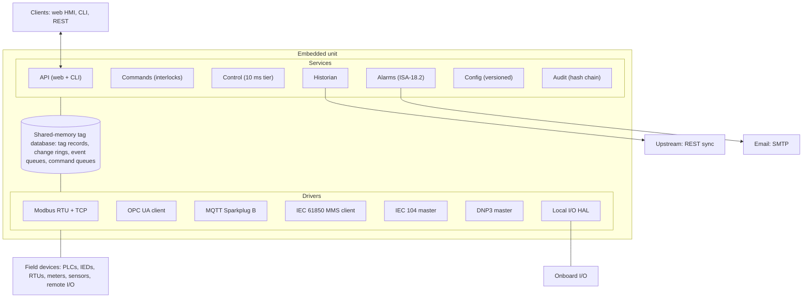

# SCADA Reference Architecture

Nov 12, 2026 · @Malek

**Version 1.1, frozen on 13 November 2026; section 5 updated on 16 November 2026 (change log).** This is the baseline for the build. Later changes are reviewed before they are made and recorded in the change log (section 20).

## 1. Purpose and scope

This document specifies a SCADA system that runs on one embedded Linux PC per site: it collects and logs data, controls field devices, and serves a web HMI and a local CLI. It is written for the AI or engineering team that will build the system, and it fixes the architecture and the main interfaces so that the builder designs modules, not the system.

The words **must**, **should** and **may** are used deliberately. "Must" is a requirement, "should" is the default unless the builder has a stated reason, and "may" is optional.

**In scope**

- One self-contained unit per site, with an optional upstream link for REST access and historian sync. Units may also be linked as one master and several slaves (section 17).
- Data acquisition as client or master over Modbus RTU/TCP, OPC UA, MQTT Sparkplug B, IEC 61850 MMS, IEC 60870-5-104 and DNP3, plus local DI/DO/AI/AO.
- Supervisory control, with an optional 10 ms control tier that falls back to soft real-time.
- Historian, ISA-18.2 alarm management, email notification, web HMI with an in-browser editor, local CLI.
- File-based configuration, security, deployment and resilience.

**Out of scope for this version**

- Acting as an outstation or server to a control center (IEC 104, DNP3 or OPC UA server roles).
- IEC 61850 GOOSE and sampled values.
- Redundant unit pairs with automatic failover, and central fleet management.
- Sequence-of-events recording at 1 ms resolution.
- SMS or push notifications.
- Motion-class control (1 ms or faster) and real-time fieldbuses such as EtherCAT.
- A whole-OS image with A/B updates. The design must not block adding it later (section 14).

* Plant-controller functions for PV and BESS sites: grid-operator interface, grid-code function blocks, and inverter and meter templates. The system is a general-purpose controller; these can be added later (section 19.3).

## 2. Decision summary

Every row below was agreed with the product owner; later sections elaborate them and must not contradict them.

| Area | Decision |
| --- | --- |
| Platform | Linux only; x86 industrial PCs and ARM boards from one codebase |
| Scale | 50,000 tags per unit; hundreds of devices |
| Data plane | One shared-memory tag database; no internal message broker |
| Field protocols | Modbus RTU/TCP, OPC UA, MQTT Sparkplug B, IEC 61850 MMS, IEC 60870-5-104, DNP3; client or master role only |
| Local I/O | DI/DO/AI/AO through one hardware abstraction layer, for onboard and remote I/O |
| Control | Supervisory by default; 10 ms tier on a real-time kernel, automatic fallback to soft real-time |
| Control logic | Function blocks declared in config files, plus a small structured-text subset; to be revisited |
| Upstream | REST API and historian sync |
| Historian | SQLite plus custom time-series files; sampling granularity and retention set per tag; aggregate tier intervals configurable |
| Alarms | ISA-18.2 life cycle; email notifications only |
| Web HMI | Mimic diagrams, widget dashboards, built-in standard pages, in-browser editor; remote browsers only |
| Local CLI | Monitoring, control and configuration through the API, plus a restricted emergency direct mode |
| Configuration | Files are the source of truth, edited by web UI or CLI with validation, versioning and rollback |
| Time sync | NTP servers are part of system configuration |
| Commands | Select-before-operate, confirmation with reason, interlock checks, local/remote authority |
| Security | Local users with roles, encrypted communication, full audit trail, signed software and config, IEC 62443 alignment |
| Deployment | Distribution-agnostic; systemd services installed from native packages in a format chosen later; whole-OS A/B image later |
| Resilience | Service supervision and watchdog, power-loss safety, fail-safe outputs, config backup and restore |
| Languages | C++ for all backend services; TypeScript for the web app |
| Licensing | Undecided; every driver stays replaceable behind one interface (section 16) |
| Minimum hardware | Undecided; sizing tiers are defined instead (section 15) |
| Multi-node | Optional master and slave roles: a master reads tags from, and commands devices on, slave units over a direct mutual-TLS node link (section 17) |
| Virtual tags | Tags computed from other tags by an expression in the tag definition; logged, alarmed and displayed like any tag (section 7.6) |

## 3. System overview

The unit is a set of independent C++ processes that all attach to one shared-memory tag database; no process calls another directly for live data. Drivers write device values into it, the control runtime and services read from it, and commands travel to drivers through queues inside it.



Services sit above the tag database and drivers below it; the only paths out of the unit are the API, upstream sync, email and the field connections.

### 3.1 Processes

The process names below are proposals; the builder may rename them but must keep the separation.

| Process | Responsibility | Section |
| --- | --- | --- |
| `scada-tagd` | Creates the shared-memory segment from configuration, owns its layout, marks stale tags, persists retained values | 5 |
| `scada-drv-<protocol>` | One process per protocol: polls devices, writes input tags, executes write requests | 6 |
| `scada-io` | Local I/O hardware abstraction; behaves as a driver | 6 |
| `scada-control` | Cyclic control tasks: function blocks and structured text | 7 |
| `scada-cmd` | Command gateway: select-before-operate, interlocks, authority | 8 |
| `scada-hist` | Historian storage, retention, and upstream sync | 9 |
| `scada-alarm` | Alarm engine, event journal, email notifier | 10 |
| `scada-api` | HTTPS REST and WebSocket API, serves the web HMI, authenticates users | 11 |
| `scada-conf` | Validates, versions, applies and rolls back configuration | 12 |
| `scada-audit` | Tamper-evident audit journal | 13 |
| `scadactl` | Local CLI; a client of `scada-api`, with an emergency direct mode | 11 |
| scada-link | Slave units only: exports selected tags and outputs to the master over the node link | 17 |
| scada-drv-link | Master units only: a driver that presents each slave's exported tags as local tags | 17 |

### 3.2 Main data flows

1. **Acquisition:** a driver polls a device, or receives a report, and writes value, quality and timestamp to input tags.
2. **Control:** `scada-control` snapshots input tags each cycle, runs logic, and posts write requests to the owning driver's command queue.
3. **Operator command:** browser or CLI calls `scada-api`, which hands the command to `scada-cmd`; after its checks pass, `scada-cmd` posts the write request to the driver's queue.
4. **Logging:** `scada-hist` consumes the tag change queue and writes time-series files; it later pushes closed files upstream.
5. **Alarming:** `scada-alarm` evaluates alarm conditions on tag changes, writes alarm state tags and journal entries, and sends email.
6. **Display:** `scada-api` reads live values and events from shared memory and pushes them to browsers over WebSocket.
7. **Configuration:** `scada-conf` validates a change, commits a new version, and signals affected processes to reload.

### 3.3 Rules that hold everywhere

- A process must tolerate any other process being absent or restarting. Only `scada-tagd` is a hard dependency for all.
- Every tag has exactly one writing process (section 5.4).
- Every action that changes the plant or the configuration must produce an audit entry, whatever its origin.
- Protocol specifics must not leak past the driver boundary; everything above a driver sees only tags and write requests.

## 4. Platform and process model

The system targets 64-bit Linux on x86-64 and ARM64, with each process running as a systemd service under its own unprivileged user.

### 4.1 Operating system

- The design is distribution-agnostic. It requires a 64-bit Linux with systemd and a kernel that can run the real-time tier; the distribution and the package format are chosen later (section 19.1). No code may depend on a distribution-specific path, tool or package manager.
- The code must build for x86-64 and ARM64 from one source tree with CMake, using C++20 and no architecture-specific code outside the I/O HAL.
- 32-bit targets are not supported; the shared-memory layout assumes 64-bit atomics.

### 4.2 Service model

- Each process is a systemd unit of type `notify` with `WatchdogSec` set, so systemd restarts a hung process as well as a crashed one.
- Start order: `scada-tagd`, then `scada-conf` and `scada-audit`, then drivers and `scada-io`, then `scada-control` and `scada-cmd`, then the remaining services.
- Each service runs as its own system user. All belong to a `scada` group that grants access to the shared-memory segment; per-region access is narrowed further (section 5.4).
- Services must use systemd sandboxing: `ProtectSystem=strict`, `NoNewPrivileges=yes`, `PrivateTmp=yes`, and capabilities limited to what each needs (for example serial port access for the Modbus driver).

### 4.3 Real-time tier and fallback

The 10 ms tier applies to `scada-control`, `scada-io` and any driver assigned to a fast poll group.

1. At start, `scada-control` checks whether the kernel is PREEMPT\_RT and whether it holds permission for `SCHED_FIFO` and `mlockall`.
2. If both hold, real-time tasks run under `SCHED_FIFO` with locked memory, pre-faulted stacks, and no heap allocation inside the cycle. CPU isolation for these threads should be configurable.
3. If either fails, the same tasks run under the normal scheduler at the same period. The unit raises a standing system alarm, "real-time tier unavailable", and sets a status tag.
4. In both modes, each task records its cycle time, jitter and overruns in system tags. An overrun must never be silent.

Fallback is automatic and never prevents start-up. Whether a project may operate in fallback mode is a configuration choice: a task can be marked `rt_required`, in which case its outputs go to their safe state when the real-time tier is unavailable.

### 4.4 Directory layout

| Path | Content |
| --- | --- |
| `/etc/scada/` | Active configuration files (section 12) |
| `/var/lib/scada/config-history/` | Committed configuration versions |
| `/var/lib/scada/hist/` | Time-series files and the historian index |
| `/var/lib/scada/journal/` | Alarm, event and audit journals |
| `/var/lib/scada/retain/` | Retained tag values |
| `/dev/shm/scada/` | The shared-memory segment |
| `/run/scada/` | Unix sockets and runtime state |
| `/usr/lib/scada/`, `/usr/bin/` | Binaries and driver plugins |
| `/usr/share/scada/web/` | Built web app static files |

Everything that changes at runtime lives under `/var/lib/scada`, so the root filesystem can be mounted read-only (section 14).

## 5. Tag database

The tag database is the only data plane: a set of shared-memory regions under `/dev/shm/scada/` holding live tag values, change rings, reliable event queues and command queues. All access goes through one client library, `libscada-tag`, so no service touches the raw layout. The binary layout, the protocols and the library interface are specified in the tag database contract (`docs/contracts/tag-database.md`, version 1.0); this section summarises it.

### 5.1 Regions

The database is split into one region file per writer, so the operating system enforces the one-writer rule: the region's file belongs to the service user that writes it, which maps it read-write, and everyone else maps it read-only. An owner is one writing thread of a process (for example one per control task or driver channel), so a process with several writing threads has several owners, and every ring and queue keeps one lock-free writer.

| Region | Writer | Content |
| --- | --- | --- |
| `header` | `scada-tagd` | Magic, layout version, config generation and its state, owner, process and queue tables (with the `down` flag of each process), tag directory (name hash to owner and slot) |
| `proc.<process>` | That process | Heartbeat, cycle counter (`cycle_seq`), read cursors of the queues it consumes |
| `tags.<owner>` | The owner | Array of tag records for the tags that owner writes |
| `changes.<owner>` | The owner | Broadcast ring of tag changes from that owner |
| `events.<producer>` | The producing thread | Reliable queue of journal events (alarms, commands, audit) |
| `cmd.<driver>.<source>` | The source (`control` or `cmd`) | Write requests for that driver |
| `result.<driver>.<source>` | The driver | Results of those write requests |
| `strings.<owner>` | The owner | Fixed-size slots for string tag values |

- The header holds no heartbeats: a process cannot write to a region of `scada-tagd`, so each heartbeat and queue cursor lives in the process's own `proc` region.
- Each process creates its own regions when it attaches, from the sizes in `header`. `scada-tagd` creates only the generation directory and `header`, so it never creates files for another user.
- The base directory `/dev/shm/scada/` is created at boot by the platform, not by `scada-tagd`.
- The minimum kernel is Linux 5.16.

### 5.2 Tag record

A tag record is 64 bytes, aligned to a cache line, and protected by a sequence lock. Because each tag has one writer, the writer never waits. A reader retries up to 64 times while it finds a write in progress; then the read returns `SCADA_E_BUSY`, not a BAD value, and the caller keeps its previous value for that cycle.

```cpp
struct TagRecord {              // 64 bytes, alignas(64)
  uint32_t seq;                 // odd while the owner is writing
  uint8_t  type;                // BOOL, INT64, UINT64, FLOAT64, STRING
  uint8_t  quality;             // GOOD, UNCERTAIN, BAD
  uint16_t quality_flags;       // STALE, COMM_FAIL, OUT_OF_RANGE, SUBSTITUTED,
                                // NOT_INIT, OWNER_DOWN, TIME_UNCERTAIN, BLOCKED,
                                // TEST, OVERFLOW, RESTORED, LOCAL_TIME
  uint64_t value;               // bit pattern of the type; a STRING's slot number
  int64_t  source_time_ns;      // device timestamp when the protocol has one, UTC
  int64_t  update_time_ns;      // when the owner wrote it, CLOCK_REALTIME
  int64_t  update_mono_ns;      // same instant, CLOCK_MONOTONIC, for age
  uint32_t change_count;        // +1 on every change of value, quality or flags
  uint8_t  reserved[20];
};
```

- Shared structures hold plain integers. A field shared between processes while it changes is read and written atomically, field by field; no `std::atomic` object is placed in shared memory.
- OWNER_DOWN is never stored: a read adds it while the owner is down (section 5.4). STALE is set by the owner, not by `scada-tagd`, which never writes a tag record.
- Without a device timestamp the owner sets `source_time_ns` to the update time and sets LOCAL_TIME.

Age calculations must use `update_mono_ns`, because NTP can step the wall clock. Engineering-unit scaling is applied by the driver before writing, so every reader sees scaled values.

### 5.3 Rings and queues

Three mechanisms carry everything that is not a current value. All are single-producer, which keeps them lock-free.

| Mechanism | Delivery | Used for | When full |
| --- | --- | --- | --- |
| Change ring (`changes.*`) | Broadcast; each consumer keeps its own cursor | Tag changes for historian, alarms, API | Oldest entries are overwritten; a lagging consumer detects the gap from the ring's write count and resynchronises from the tag records |
| Event queue (`events.*`) | Reliable, one consumer, at least once | Alarm transitions, command records, audit entries | The post is refused (`SCADA_E_FULL`) and the producer must not proceed |
| Command queue (`cmd.*`, `result.*`) | One consumer; requests at most once, results at least once | Write requests to drivers and their results | The post is refused (`SCADA_E_FULL`); the requester gets a "queue full" rejection |

- A change entry holds tag handle, type, value, quality and flags, source time and update monotonic time (32 bytes), and no sequence number of its own. A consumer also gets a gap when the owner restarts (the ring's epoch changes), when the owner's process goes down or comes back, and when the ring file appears, disappears or is replaced. Default ring size is 65,536 entries per owner and is configurable; it must be at least twice the owner's tag count.
- A subscription is per owner; a filter by tag is applied by the caller.
- The rule for event queues is **no audit, no action**: if a command cannot be journalled, it is rejected. Every write request, `AUTO` included, needs its event record accepted first.
- When the historian detects a change-ring gap, it must write a gap marker for the affected tags so that missing data is visible, not silently interpolated.
- A command is never executed twice and never executed late. A driver takes a request before it acts on it, so a request is not delivered again after a driver crash. When a driver attaches, the library drains the requests still in its command queues without executing them and answers each `ABORTED`; selections do not survive a driver restart. A request that has expired, or whose lifetime is longer than the limit (60 seconds), is answered `EXPIRED` by the library and never reaches the driver.
- Consumers sleep until new entries arrive, on a shared futex in the read-only mapping. Writers never wake anyone: a thread calls `scada_tag_notify` after its writes and posts (a real-time task once per cycle), so `write` and the queue post make no system call. A wait is capped at 100 ms, so a missed notify delays delivery but cannot lose it.
- Limits of the reliable queues (contract 9.3): a consumer that has just died is seen as down only after its heartbeat timeout; a queue file created anew inside a generation loses the records of the old file that its consumer no longer holds, and `scada-tagd` logs the ids that may be lost; record ids of a new file continue from a base sequence, so they do not repeat while the producer's `proc` region or the consumer's cursor survives (contract 3.3 gives the exceptions); records left in a retiring generation are not carried into the next.

A write request and its result have these fields:

| Record | Fields |
| --- | --- |
| Write request | Request id, target tag handle, value, operation (`DIRECT`, `SELECT`, `OPERATE`, `CANCEL`, `READ_NOW`), source (`AUTO`, `OPERATOR` or `REMOTE`), user id, expiry time, posted time, `select_request_id` (the `SELECT` an `OPERATE` or `CANCEL` belongs to) |
| Result | Request id, status (`OK`, `REJECTED`, `TIMEOUT`, `DEVICE_ERROR`, `NOT_AUTHORISED`, `EXPIRED`, `ABORTED`), protocol error code, completion time |

### 5.4 Ownership rules

- Every tag is assigned to exactly one owner in configuration. Input and feedback tags belong to their driver; calculated tags to `scada-control`; alarm state tags to `scada-alarm`; system tags to the process they describe.
- An output is modelled as two tags plus a queue: a **request** tag owned by whoever commands it, a **feedback** tag owned by the driver, and the write request that travels through the command queue (section 8).
- Each process writes a heartbeat in its `proc` region at an interval of at most one third of its heartbeat timeout. The defaults are 3,000 ms, and 500 ms for real-time processes.
- Each reader judges liveness itself from the heartbeat: a process is down when its `proc` region is missing or not ready, its state is not running, or its heartbeat is older than its timeout (or further than the timeout ahead of the reader's clock). A clean stop therefore reads as down at once, and detection does not depend on `scada-tagd`. While the owner's process is down, `libscada-tag` reports quality `BAD` with `OWNER_DOWN` for every tag of that owner on read.
- `scada-tagd` evaluates the same rules and keeps a `down` flag per process in the process table. The flag is for reporting and alarms only; readers do not use it.
- Every age and timeout uses `CLOCK_MONOTONIC`. The unit therefore must not suspend, hibernate or hybrid-sleep, and processes must not run in a private time namespace (contract 3.4). `scada-tagd` reports a suspend it detects and does not act on it.

### 5.5 Versioning and reconfiguration

- The header carries a layout version (the binary structure) and a config generation (the set of tags). `libscada-tag` refuses to attach when its compiled layout version differs.
- Changes that do not alter the tag set (alarm limits, poll rates, scaling, logic parameters) are applied live by a reload signal.
- Restarting `scada-tagd` with an unchanged tag set keeps the generation, and the other processes keep running.
- Changes that add, remove or retype tags create a new generation. `scada-tagd` builds it and marks the old one `RETIRING`. Each process then drains its queues (requests still queued are answered `ABORTED`), detaches, attaches to the new generation and resolves its handles again. Retained values are handed over through retain files that `scada-tagd` writes, marked final, once each owner has left the old generation. `scada-conf` performs the coordinated restart: outputs hold their last value or go to their safe state as configured, services reattach, and retained values are restored. This should complete within a configurable time limit (default 5 seconds; conformance test 21 checks 5 seconds). If the limit is exceeded, outputs go to their safe state and a system alarm is raised.
- Adding tags without a restart may be built later; the tag directory format should not prevent it.

### 5.6 Retained values

Tags marked `retain: true` (setpoints, auto/manual modes, counters, shelved alarm states) are written by `scada-tagd` to `/var/lib/scada/retain/`, one file per owner, at most every 5 seconds when changed (configurable), and on clean shutdown. <!-- #96 may change this bound -->Tags also marked retain-now (modes, control authority) are written within 1 second of a change. Writes must be atomic: write a temporary file, `fsync`, rename, then `fsync` the directory.

- The retain file has format version 2 and holds each value with its quality and the flags that describe the value; a restored value reads `UNCERTAIN` with `RESTORED` until the owner writes it.
- At a generation change the file of an owner that left the old generation is marked final, so that the new generation restores the last values written there.
- String tags cannot be retained.

### 5.7 Client library

`libscada-tag` is a C++ library with a plain C interface underneath, so other languages can bind to it later. The C interface is the stable one; the contract gives every function. It provides:

- `scada_tag_attach` and `scada_tag_detach`; `scada_tag_heartbeat`, `scada_tag_notify` and `scada_tag_status`.
- `scada_tag_observe`: a read-only observer context that needs no entry in the process table, creates no file and writes nothing, for tools such as `scadactl` (sections 11.5, 11.6). Read access is membership of group `scada`.
- `scada_tag_resolve`, returning a handle for the current generation.
- `scada_tag_read` and `scada_tag_read_many`, returning value, quality, timestamps and age.
- `scada_tag_write` and `scada_tag_write_many`, for the owner thread only; string tags have their own read and write functions.
- `scada_sub_open` and `scada_sub_next(timeout)` for change rings, per owner.
- `scada_queue_open`, `scada_queue_post`, `scada_queue_next(timeout)` and `scada_queue_ack` for event and command queues; command queues deliver at most once.
- Wait sets over several rings, queues and cycle counters, with a file descriptor for `poll` and `epoll`.
- Functions used inside real-time tasks must not allocate, block or enter the kernel. The real-time-safe functions are `scada_tag_read`, `scada_tag_read_many`, `scada_tag_write`, `scada_tag_write_many`, `scada_queue_post`, `scada_tag_heartbeat`, `scada_proc_status` and `scada_tag_handle`. Clocks are read through the vDSO; the library checks that this holds and reports it when it does not.

### 5.8 Size

At 50,000 tags the tag records occupy 3.2 MB. Measured in phase 1 on the pipeline runners, the whole database for 50,000 tags and 10 owners with change rings of 65,536 entries is 28.8 MB, under 64 MB.

## 6. Drivers and I/O HAL

Each protocol is a separate process built on one driver framework, so a new protocol means implementing one interface, and a crashing protocol stack cannot take down control or other drivers.

### 6.1 Driver framework

A shared library, `libscada-driver`, supplies everything that is not protocol-specific: configuration loading, tag binding, poll scheduling, command queue handling, statistics, heartbeat and reload. A protocol implements this interface:

```cpp
class ProtocolDriver {
public:
  virtual Status configure(const DriverConfig&) = 0;      // parse channels, devices, points
  virtual Status connect(Channel&) = 0;                   // open port or session
  virtual void   disconnect(Channel&) = 0;
  virtual Status poll(Device&, PollGroup&, Samples& out) = 0;   // polled protocols
  virtual void   on_unsolicited(Device&, Samples& out) {}       // report-driven protocols
  virtual Result write(Device&, const WriteRequest&) = 0;       // DIRECT, SELECT, OPERATE, CANCEL
  virtual Status read_now(Device&, PointRef, Samples& out) = 0;
  virtual ~ProtocolDriver() = default;
};
```

The hierarchy is **driver, channel, device, point**. A channel is one physical or logical connection (a serial port, a TCP connection, a broker session). Each channel runs in its own worker thread, so a slow device only delays others on the same channel.

### 6.2 Polling model

- Points are assigned to **poll groups**, each with a period and a priority. A typical set is `fast` (for control inputs), `normal` and `slow`.
- Within a channel, the scheduler serves pending write requests first, then poll groups by priority, then by due time.
- The framework must merge adjacent points into block reads where the protocol allows it (for example contiguous Modbus registers), within a configurable maximum gap.
- Each device has a timeout and a retry count. After a configurable number of consecutive failures the device is **demoted**: its tags go to `BAD` with `COMM_FAIL`, and it is retried at a slow backoff rate so that it stops stalling the channel.
- If a point is not refreshed within its `max_age`, its tag gets the `STALE` flag. Marking staleness is the driver's job for its own tags.
- A **synchronous scan group** may be configured for a small set of devices: the driver signals `scada-control` at the end of each scan, and a control task bound to that group runs once per scan (read, compute, write) instead of on a timer.

### 6.3 Diagnostics

Every driver must publish system tags per channel and per device: connection state, last successful poll time, actual poll period per group, request count, error count, timeout count and average response time. The actual poll period is what section 7.5 validates control tasks against.

### 6.4 Protocol notes

All drivers act as client or master only.

| Driver | Must support | Notes |
| --- | --- | --- |
| Modbus | RTU over RS-485 and TCP; function codes 1 to 6, 15, 16; configurable byte and word order; bit extraction | One channel per serial port; several devices per port |
| OPC UA | Client with subscriptions (monitored items) and fallback to polled reads; security policies with certificates | Source timestamps and status codes map to tag timestamp and quality |
| MQTT Sparkplug B | Host application role: consumes birth, data and death messages; issues commands | Death messages set tags to `BAD`; plain MQTT with JSON topic mapping should also be supported |
| IEC 61850 | MMS client: data sets, buffered and unbuffered reports, direct and select-before-operate control models; SCL file import for point lists | GOOSE is deferred |
| IEC 60870-5-104 | Controlling station: general interrogation, spontaneous data, clock sync, single and double commands with select and execute, setpoints | Device timestamps preserved |
| DNP3 | Master: integrity and event polls, unsolicited responses, select-before-operate and direct operate, time sync | Device timestamps and flags map to tag timestamp and quality |

Where a protocol has a native select-before-operate procedure, the driver must use it for `SELECT` and `OPERATE` requests. Where it does not (Modbus), the driver accepts `OPERATE` after a `SELECT` held by the command gateway (section 8.2).

### 6.5 Local I/O HAL

`scada-io` presents onboard hardware as ordinary tags, using the same framework. Remote I/O modules are simply devices under a protocol driver, so logic cannot tell the two apart.

- Hardware backends are plugins behind one interface with four calls: `read_inputs`, `write_outputs`, `describe_channels` and `set_safe_state`.
- Initial backends should be Linux GPIO (the character-device interface) for digital I/O and Linux IIO for analog I/O. Vendor I/O cards are added as further backends.
- A `simulator` backend must exist from the first build phase, so every other component can be developed and tested without hardware.
- `scada-io` scans at the fastest control task period (10 ms by default) and is part of the real-time tier.
- Digital inputs support configurable debounce; analog channels support scaling, clamping and a filter time constant.
- Every output channel has a configured **safe state** (`off`, `on`, `hold`, or a value). `scada-io` applies it when the control runtime's heartbeat stops, when a hardware watchdog is about to expire, and on shutdown (section 14.4).

## 7. Control runtime

`scada-control` runs cyclic tasks that read a snapshot of input tags, execute function blocks and structured text, and post write requests; it never talks to a driver or a device directly.

### 7.1 Tasks

- A **task** has a name, a period, a priority and an ordered list of programs. Default tasks are `fast` (10 ms), `normal` (100 ms) and `slow` (1 s); periods are configurable from 10 ms upward.
- A task may instead be bound to a synchronous scan group (section 6.2) and run once per driver scan.
- Each task runs in its own thread. In the real-time tier the `fast` task runs under `SCHED_FIFO`; other tasks should run at lower priority so they cannot delay it.

### 7.2 The cycle

1. **Snapshot:** copy every input tag the task uses into task-local memory with `read_many`. Values cannot change during the cycle.
2. **Execute:** run the task's programs in order. Blocks read inputs with their quality and age.
3. **Publish:** write calculated tags, then post write requests for outputs whose requested value changed or whose refresh interval expired.
4. **Collect:** read pending results from drivers and expose them to the logic as status inputs for the next cycle.
5. **Account:** update the task's cycle time, jitter and overrun counters.

If a cycle overruns its period, the next cycle starts immediately and the overrun is counted. A configurable number of consecutive overruns raises a system alarm.

### 7.3 Function blocks

Function blocks are compiled C++ classes registered by type name, instantiated and wired entirely from configuration files (section 12). The initial library should include:

| Group | Blocks |
| --- | --- |
| Logic | AND, OR, NOT, XOR, SR and RS latches, rising and falling edge |
| Timing | On-delay, off-delay, pulse, scheduler (time of day, day of week) |
| Comparison and maths | Compare, limit, select, scale, deadband, min, max, average, rate limiter, totaliser |
| Regulation | PID with anti-windup, bumpless auto/manual transfer and output tracking; on/off controller with hysteresis |
| Sequencing | Step sequencer with transition conditions and step timeouts |
| Protection | Interlock (permissive list producing a blocked reason), watchdog |
| Output | Analog output, digital output and pulsed command blocks that create write requests and compare feedback |

Every block must follow these rules:

- Time-dependent blocks use the measured time since the previous sample of their input, taken from tag timestamps, not the nominal task period.
- Every input pin carries quality and age. Each block declares its behaviour on bad or stale input: `hold`, `safe_value` or `propagate`. The default for regulation and output blocks is `hold`, then `safe_value` after a configured time.
- Blocks must not allocate memory, block, or perform I/O during execution.
- Block parameters marked tunable (for example PID gains) are exposed as tags, so they can be changed from the HMI with an audit entry and retained across restarts.

Custom C++ blocks may be added as plugins built against the block SDK; this is the extension path for logic the built-in set cannot express.

### 7.4 Structured-text subset

Structured text is for expressions and small programs that would be awkward as wired blocks. The subset is deliberately small and may be extended later.

- Types: `BOOL`, `INT` (64-bit), `REAL` (64-bit), `TIME`.
- Statements: assignment, `IF / ELSIF / ELSE`, `CASE`, bounded `FOR`. No `WHILE` or `REPEAT`, so execution time is bounded.
- Expressions: arithmetic, comparison, boolean operators, and calls to the built-in function blocks and maths functions.
- Tag access by name, with `.quality` and `.age` attributes.
- No pointers, dynamic memory, recursion or user-defined types.

Programs are compiled to bytecode when configuration is validated, so syntax and type errors block the commit. The interpreter must enforce a per-program instruction budget each cycle and raise a system alarm if it is exceeded.

### 7.5 Determinism by transport

The runtime is deterministic; the devices behind it often are not. Polled protocols deliver values at irregular ages and execute writes after variable delays, so loop speed must match the transport.

| Transport | Realistic control period |
| --- | --- |
| Onboard I/O through `scada-io` | 10 ms |
| Modbus TCP or OPC UA on a dedicated network | 50 to 100 ms |
| IEC 61850, IEC 104, DNP3 (report or event driven) | 100 ms to 1 s, depending on the device |
| Modbus RTU on a shared serial line | 500 ms to several seconds |
| Tags imported from a slave unit over the node link (section 17) | 50 to 100 ms |

These figures are engineering guidance, not measured values, and must be confirmed per project. The system enforces the principle in three ways:

- Each control input has a `max_age`; beyond it the consuming block applies its bad-input behaviour.
- The configuration validator must warn when a task's period is shorter than the poll period of any input it uses, and must reject the configuration if the task is marked `rt_required` and uses inputs outside `scada-io` or a synchronous scan group.
- At runtime, the measured poll period (section 6.3) is compared with the configured one; a sustained shortfall raises a system alarm.

Control that must be faster than its transport allows belongs in the device or a PLC, with the unit sending setpoints.

### 7.6 Virtual tags

A virtual tag is a tag whose value is computed from other tags by an expression written in its own definition, with no control program needed. Once defined it is an ordinary tag: it can be logged, alarmed, trended, shown on screens, used in logic and exported over the node link.

- The expression uses the structured-text expression syntax of section 7.4: arithmetic, comparison, boolean logic, conditional selection and the built-in maths functions.
- Aggregate functions combine several tags into one: `sum`, `avg`, `min`, `max` and `count_good`, over a list of tags or a name pattern such as `sum("ps1.inv*.power")`. A pattern is resolved when configuration is validated, not at runtime.
- Time functions work on a tag's own history within the task: moving average, rate of change, and a totaliser that integrates a rate into a quantity.
- Virtual tags are evaluated by `scada-control`, which owns them, once per cycle of the task named in the definition (default `normal`, 100 ms). A virtual tag may use other virtual tags; the validator orders them and rejects circular references.
- Quality follows the inputs. With `quality: worst` (the default) the result takes the worst input quality. With `quality: ignore_bad`, aggregate functions skip bad inputs and the result is marked `UNCERTAIN`.
- The timestamp is the newest source time among the inputs, so a logged virtual tag lines up with the data it was computed from.
- Expressions are compiled and type-checked at validation, and run under the same instruction budget as structured-text programs.

## 8. Command handling

Every operator command, from the web HMI, the CLI or the REST API, passes through `scada-cmd`, which applies the same checks in the same order whatever the protocol behind the output.

### 8.1 Output model

Each controllable point is declared once in configuration as an **output** with these parts:

| Part | Owner | Purpose |
| --- | --- | --- |
| Request tag | `scada-control` in auto, `scada-cmd` in manual | The value last requested |
| Feedback tag | The driver | The state the device reports |
| Mode tag | `scada-cmd` | `AUTO` or `MANUAL`; retained |
| Status tag | `scada-cmd` | `IDLE`, `SELECTED`, `EXECUTING`, `OK`, `FAILED`, `BLOCKED` |

Because a tag has one owner, the request is stored as two tags (auto request, manual request) and the driver framework reads the one that matches the mode. The driver accepts `AUTO`-sourced write requests only when the mode is `AUTO`, and `OPERATOR`-sourced ones only when it is `MANUAL`; anything else is answered `NOT_AUTHORISED`.

On a slave unit an output can have a third mode, `REMOTE`, in which the request comes from the master's control logic (section 17.4).

### 8.2 Checks, in order

1. **Authentication and permission:** `scada-api` confirms the user's role allows control of this output's area.
2. **Authority:** the commanding location must hold control authority for the area (section 8.3).
3. **Mode:** the output must be in `MANUAL`, or the command is a mode change.
4. **Value validation:** type, range, and rate-of-change limits from configuration.
5. **Interlocks:** every interlock condition bound to the output must be satisfied. If one is not, the command is refused and the reply names the blocking condition.
6. **Select:** for outputs configured `sbo: true`, the first request selects the output for one user and starts a timeout (default 30 seconds). A second user cannot select it meanwhile.
7. **Confirmation and reason:** the client must send an explicit confirmation, with a reason text when the output is configured `reason_required: true`.
8. **Audit:** the command record is written to the event queue. If that fails, the command stops here.
9. **Operate:** the write request is posted to the driver, with an expiry time.
10. **Verify:** `scada-cmd` waits for the driver's result, then for the feedback tag to match within the output's `feedback_timeout`. A mismatch sets status `FAILED` and raises a command-failure alarm.

Interlocks are re-evaluated at step 9, immediately before the request is posted, because conditions can change between select and operate.

### 8.3 Control authority

Control authority decides where commands may come from, per configured **area** (a named group of outputs).

- Authority locations are `LOCAL_PANEL`, `CLI`, `WEB` and `API`.
- `LOCAL_PANEL` is bound to a digital input tag from a physical local/remote switch, where one exists. While it is active, every command from the unit to that area is refused, including automatic ones if the area is configured `local_blocks_auto: true`.
- Among `CLI`, `WEB` and `API`, exactly one holds authority per area at a time. A user with the required permission can take authority; the transfer is audited and shown on every HMI session.
- Authority state is retained across restarts.

On a slave unit, `MASTER` is a further authority location for commands arriving over the node link (section 17.4).

### 8.4 Interlocks in automatic control

Automatic outputs do not pass through `scada-cmd`, so their safety conditions are part of the logic: the output blocks of section 7.3 take an interlock input and will not issue a request while it is false. An interlock definition in configuration is therefore usable in two places, as a permissive for operator commands and as an input to control blocks, and must be declared once.

### 8.5 Limits of this design

Interlocks here are operational protections implemented in software on a general-purpose computer. They are not a safety instrumented system and must not be the only barrier against harm to people or equipment; such protection belongs in certified hardware or protection relays.

## 9. Historian and upstream sync

`scada-hist` stores samples in compressed, append-only time-series files and keeps a SQLite index of those files; sampling granularity and retention are set per tag, with named policies as reusable defaults.

### 9.1 What is logged

Logging is configured per tag. Every tag has its own **logging settings**, listed below. A tag can take them from a named policy, override individual settings of that policy, or define them all inline (section 12.3).

| Setting | Meaning |
| --- | --- |
| `mode` | `on_change`, `periodic`, or `both` |
| `deadband` | Minimum change (absolute or percent of range) that produces a sample in `on_change` mode |
| `interval` | Sample period in `periodic` mode |
| `max_interval` | In `on_change` mode, a sample is forced after this time so that gaps are distinguishable from steady values |
| `raw_retention` | How long full-resolution samples are kept |
| `tiers` | Retention for each aggregate tier the tag keeps, by tier name; a tier that is not listed is not kept (written as a tiers map, see section 12.3) |

Quality changes are always logged. Each sample stores timestamp, value and quality. The timestamp is the source time when the device supplies one, otherwise the update time.

Rules for per-tag granularity:

- `interval` can be set from 10 ms upward. The validator warns when it is finer than the rate at which the tag is actually refreshed (its poll group or task period), because the extra samples would carry no new information.
- Logging settings are editable at runtime from the web HMI's tag configuration page and from the CLI, for one tag or in bulk for all tags matching a filter. A change is an ordinary configuration commit: validated, versioned, audited, and applied live with no restart.
- A change to sampling settings takes effect from the next sample. A change to retention applies to data recorded from the next partition onward; data already stored keeps the retention it was recorded under.
- Aggregate tier intervals are configurable. The logging configuration defines up to four tiers for the unit, each with a name and an interval between 1 second and 1 day; the defaults are 1 minute and 1 hour. Per tag, the choice is which tiers are kept and for how long.

Each tier's interval must be a whole multiple of the tier below it, so a higher tier can be computed from a lower one. A change to a tier's interval applies to data recorded from the next partition; files already written keep the interval they were written with, and queries handle both.

### 9.2 Storage layout

- The historian groups tags automatically into retention classes, one per distinct combination of retention settings, and each class writes its own series of files. Sampling settings do not affect the grouping. The validator warns when a configuration creates more than 32 classes. Retention is then enforced by deleting whole files, never by rewriting them.
- Each file is a **partition** covering a fixed time window per tier: 1 hour for raw data, and for each aggregate tier a window sized to its interval (1 day for a 1-minute tier, 1 month for a 1-hour tier). The footer records the tier's interval.
- Inside a partition, samples are stored in per-tag blocks, with delta-of-delta encoding for timestamps and XOR encoding for floating-point values, then a general-purpose compressor such as Zstandard.
- A partition ends with a footer: per-tag block index, sample counts, time range and a checksum. Once closed it is immutable.
- Aggregates hold minimum, maximum, time-weighted average, last value, sample count and the share of time with good quality.

### 9.3 Write path and crash safety

1. Samples from the change rings pass the policy filter and are appended to a write-ahead log, which is flushed to disk at a configurable interval (default 1 second).
2. Samples accumulate in memory per tag and are written to the open partition as compressed blocks every few minutes.
3. When a partition's window ends, the footer is written, the file is synced and marked closed in the SQLite index, and the corresponding log segment is deleted.
4. After a crash or power loss, `scada-hist` replays the write-ahead log, verifies the open partition, and truncates any torn block. At most the last flush interval of samples is lost.

The SQLite index holds the partition catalogue (file, retention class, tier, time range, checksum, state, sync state) and the mapping from tag names to historian ids across configuration generations, so renamed or removed tags remain queryable. SQLite must run in WAL mode with `synchronous=FULL` for this database.

### 9.4 Capacity planning

Multi-year retention of everything at 50,000 tags is a storage question, which is why retention is per tag. The figures below assume roughly 3 bytes per raw sample and 10 bytes per aggregate row after compression. Both are planning assumptions to be measured on real data in build phase 3.

| Tier, for 50,000 tags | Volume per day | Storage per year |
| --- | --- | --- |
| Raw, one sample per tag every 10 seconds on average | 432 million samples, about 1.3 GB | About 470 GB |
| 1-minute aggregates | 72 million rows, about 0.7 GB | About 260 GB |
| 1-hour aggregates | 1.2 million rows, about 12 MB | About 4.4 GB |

A workable default is therefore raw data for 90 days (about 120 GB), 1-minute aggregates for 1 year on selected tags only, and 1-hour aggregates for 10 years on all tags. The historian must monitor free space, raise an alarm below a configurable threshold, and as a last resort delete the oldest raw partitions early while recording that it did so.

### 9.5 Queries

The historian serves queries to `scada-api` over a Unix socket. It must support:

- Raw samples for a tag and time range, with paging.
- Aggregated values at a requested interval, choosing the best available tier and computing from raw data when a tier is missing.
- The last value at or before a given time.
- Down-sampling for trend display that preserves visual extremes (minimum and maximum per pixel column).
- Export to CSV.

### 9.6 Upstream sync

The unit pushes history to a central server over HTTPS; the central server never needs to reach into the unit.

- When a partition closes, it is queued for upload. Sync state is tracked per partition in the SQLite index, so the queue survives restarts and network outages of any length within the retention period.
- Upload is an HTTPS `POST` of the partition file with its id and checksum. The request must be idempotent: re-sending a partition the server already holds returns success.
- Order is configurable: newest first (fresh data reaches the centre quickly after an outage) or oldest first.
- A near-real-time stream may be added by also sending the current open hour as periodic batches.
- Alarm and event journal entries (section 10) are synced the same way, in batches by sequence number.
- The unit authenticates with a client certificate or a token from configuration; bandwidth can be limited by a configured rate and time window.

The central ingest service is outside this document's scope. The builder must publish the partition file format and the upload contract as a versioned specification so that a central historian can be written against it.

## 10. Alarms and events

`scada-alarm` evaluates alarm conditions on tag changes, maintains each alarm's state following the ISA-18.2 life cycle, records every transition in a journal, and sends email notifications.

### 10.1 Alarm definition

An alarm is defined in configuration against one tag, or as an expression over several tags.

| Setting | Meaning |
| --- | --- |
| `type` | `high_high`, `high`, `low`, `low_low`, `deviation`, `rate_of_change`, `state` (digital or enumerated), `bad_quality`, `expression` |
| `limit`, `deadband` | Threshold and the hysteresis applied on return to normal |
| `on_delay`, `off_delay` | Time the condition must persist before the alarm activates or clears |
| `priority` | `critical`, `high`, `medium`, `low`; the names and count should be configurable, with four as the default |
| `area`, `class` | Grouping for filtering, permissions and notification routing |
| `latched` | If true, the alarm stays active after the condition clears until an operator resets it |
| `suppress_when` | An expression that suppresses the alarm by design, for example while equipment is stopped |
| `message`, `guidance` | Operator text: what happened, and the recommended response |

Limits may be bound to tags, so they can be adjusted from the HMI with an audit entry.

### 10.2 States

Each alarm is always in exactly one of these states:

| State | Condition active | Acknowledged | Annunciated |
| --- | --- | --- | --- |
| Normal | No | n/a | No |
| Unacknowledged alarm | Yes | No | Yes |
| Acknowledged alarm | Yes | Yes | Yes, steady |
| Returned to normal, unacknowledged | No | No | Yes |
| Latched (unacknowledged or acknowledged) | No, awaiting reset | Either | Yes |
| Shelved | Either | n/a | No |
| Suppressed by design | Either | n/a | No |
| Out of service | Either | n/a | No |

- **Shelving** is an operator action with a mandatory duration and reason; the alarm returns automatically when the time expires. Maximum shelving time is configurable per priority.
- **Out of service** is a maintenance action that requires the engineer role and a reason.
- Shelved, suppressed and out-of-service alarms must remain visible in dedicated HMI lists.
- Current state is published as alarm state tags, and retained so that acknowledgement and shelving survive a restart.

### 10.3 Journal

Every state transition, acknowledgement, shelving action, operator command, configuration change and system event is one record in an append-only journal stored in SQLite under `/var/lib/scada/journal/`. A record holds a sequence number, timestamp, record type, source (tag, alarm or component), old and new state, value at the time, priority, user, and free text.

The journal is queried through the API with filters by time, area, priority, type and text, and is retained according to a configurable period (default 5 years). The security-relevant subset is additionally written to the audit journal (section 13.4).

### 10.4 Alarm system health

The alarm engine should compute the standard performance indicators and expose them as tags and as an HMI page: alarms per hour per area, the most frequent alarms, standing alarms older than 24 hours, chattering alarms, and counts of shelved and out-of-service alarms. These are what make alarm rationalisation possible later.

It must also raise **system alarms** about the unit itself: service down, real-time tier unavailable, task overruns, device communication failure, disk space low, time not synchronised, configuration rollback, upstream sync backlog.

### 10.5 Email notification

- Notification rules map alarm filters (area, class, priority, state transition) to recipient lists, with optional time-of-day schedules.
- Email is sent through a configured SMTP server with TLS and authentication. Credentials are stored as described in section 13.3.
- Sending is asynchronous with a persistent outbound queue and retry with backoff, so an unreachable mail server never delays the alarm engine.
- To prevent floods, notifications are grouped within a configurable window, and each rule has a maximum rate. A dropped or delayed notification raises a system alarm.
- Email is a convenience channel only. It must never be the sole means by which a critical alarm reaches an operator.

## 11. API, web HMI and CLI

`scada-api` is the single entry point for people and external systems: the web HMI, the CLI and upstream REST clients all use the same versioned API, so permissions, command checks and audit apply identically to each.

### 11.1 API service

- `scada-api` listens on HTTPS (default port 443) for remote clients and on a Unix socket, `/run/scada/api.sock`, for the local CLI.
- It reads live values, alarm states and system status directly from shared memory.
- For request-and-reply operations it calls the responsible service over local Unix sockets under `/run/scada/`: `scada-cmd` for commands, `scada-conf` for configuration, `scada-hist` for history, `scada-alarm` for acknowledgement and shelving. These sockets carry control requests only, never live data, and each service must verify the caller's identity with socket peer credentials.
- The local RPC message format should be Protocol Buffers with a length prefix, defined in one shared schema directory.
- The API is described by an OpenAPI document that the build generates and serves at `/api/v1/openapi.json`.

### 11.2 REST outline

All paths are under `/api/v1`. This outline fixes the resource model; the builder completes parameters and schemas in the OpenAPI document.

| Resource | Methods | Purpose |
| --- | --- | --- |
| `/auth/login`, `/auth/logout`, `/auth/session` | POST, GET | Session management |
| `/tags`, `/tags/{name}` | GET | Browse tags with metadata; read current value, quality, timestamps |
| `/tags/read` | POST | Read many tags in one call |
| `/history/{name}` | GET | Raw or aggregated history for a time range |
| `/outputs/{name}/select`, `/operate`, `/cancel` | POST | Command sequence of section 8.2 |
| `/outputs/{name}/mode` | PUT | Switch auto/manual |
| `/areas/{name}/authority` | GET, PUT | Read or take control authority |
| `/alarms` | GET | Current alarms with filters |
| `/alarms/{id}/ack`, `/shelve`, `/unshelve`, `/out-of-service`, `/reset` | POST | Alarm actions |
| `/journal` | GET | Alarm and event journal queries |
| `/config/...` | GET, PUT, POST | Read, stage, validate, commit, roll back, export, import (section 12) |
| `/screens`, `/screens/{id}` | GET, PUT, DELETE | Mimic and dashboard definitions |
| `/system/status`, `/system/services`, `/system/drivers` | GET | Health, service states, driver diagnostics |
| `/system/time`, `/system/network`, `/system/update` | GET, PUT, POST | System settings and software update |
| `/users`, `/roles` | GET, POST, PUT, DELETE | User administration |
| `/audit` | GET | Audit journal queries |

Errors use one JSON shape with a stable machine-readable code, a message, and for refused commands the name of the failed check and blocking condition.

### 11.3 WebSocket

One endpoint, `/api/v1/ws`, carries live data after the session is authenticated.

- The client subscribes to tag lists, alarm filters and event filters; the server sends an initial snapshot, then changes only.
- Tag updates are batched per client at a configurable maximum rate (default 4 per second), sending the latest value per tag in each batch.
- Messages are JSON by default; a compact binary encoding may be added if profiling shows a need.
- The server sends a heartbeat. A client that misses it must show a clear "connection lost" state and mark displayed values as stale, never leave old values looking live.

### 11.4 Web HMI

The web HMI is a TypeScript single-page application served as static files by `scada-api`. The front-end framework is the builder's choice; it must be one mainstream framework used consistently, with no server-side rendering.

| Page | Content |
| --- | --- |
| Mimic screens | SVG process and single-line diagrams with live values, animated symbols, navigation, and command dialogs |
| Dashboards | Grid of widgets: value tile, gauge, trend, bar, table, alarm summary, status indicator |
| Alarm pages | Current alarms, shelved, suppressed, out-of-service, alarm history, alarm system health |
| Trends | Ad hoc trend viewer: several tags, pan and zoom, cursors, export |
| Tag browser | Auto-generated tree of all tags with live values and metadata |
| Events and audit | Journal and audit viewers with filters |
| Devices | Driver, channel and device diagnostics |
| Configuration | Editors for devices, tags, alarms, logic, users, notification, system settings including time sync |
| Screen editor | In-browser editor for mimic screens and dashboards |
| System | Service status, real-time tier status, storage, software version and update |

Requirements that shape the implementation:

- A screen is stored as a JSON document in configuration (section 12): a list of elements, each with geometry, style and **bindings** from tag values to properties (text, colour, visibility, rotation, fill level).
- A symbol library supplies reusable elements (breaker, disconnector, transformer, pump, valve, motor, tank, bar, numeric field). Symbols are parameterised by tag prefix so one symbol serves many devices.
- The editor supports drag and drop, alignment, grouping, binding by tag search, preview with live data, and import of external SVG as background or as a new symbol.
- Bad or stale quality must be shown consistently on every element, with one convention defined once.
- Alarm colours and sounds are reserved for alarms; graphics should follow high-performance HMI practice with muted normal states.
- Target capacity: 10 concurrent sessions, 500 live tags per screen, screen open within 1 second on the local network.
- The application must work on current Chromium, Firefox and Safari, and adapt to tablet-size screens. It must be fully usable with no internet access: no external fonts, scripts or map tiles.
- User-interface text is externalised for translation; English is the first language.

### 11.5 Local CLI

`scadactl` is a single binary for the console or SSH. In normal mode it is a client of the API over the Unix socket, and every command is subject to the same checks as the web HMI.

- Authentication: the user runs `scadactl login` with SCADA credentials. Operating-system accounts may be mapped to SCADA users in configuration so that a logged-in engineer is recognised by socket peer credentials.
- Output is human-readable by default and JSON with `--json`, so the CLI is scriptable.
- Control commands prompt for confirmation and reason interactively; in scripts they require explicit `--confirm` and `--reason` flags.

| Command group | Examples |
| --- | --- |
| `scadactl status` | Overall health, services, real-time tier, storage, time sync |
| `scadactl tag` | `list`, `get <name>`, `watch <pattern>` (live monitor) |
| `scadactl events` | `watch` (live change and event stream), `journal --since ...` |
| `scadactl alarm` | `list`, `ack`, `shelve`, `unshelve` |
| `scadactl output` | `select`, `operate`, `cancel`, `mode` |
| `scadactl authority` | `show`, `take <area>` |
| `scadactl driver` | `list`, `stats <device>`, `poll-now <device>` |
| `scadactl config` | `validate`, `diff`, `commit`, `rollback`, `export`, `import`, `history` |
| `scadactl hist` | `query`, `export`, `sync-status` |
| `scadactl system` | `time`, `network`, `update`, `backup`, `restore`, `logs` |
| `scadactl user` | `list`, `add`, `passwd`, `disable` |

`scadactl tag watch` and `scadactl events watch` are the observability tools that replace sniffing a message broker.

### 11.6 Emergency direct mode

When `scada-api` is not responding, `scadactl --direct` attaches to shared memory itself. It is a diagnostic and recovery tool, not a second control path.

- It is available only to operating-system users in a dedicated `scada-emergency` group, and refuses to start while `scada-api` answers its health check unless `--force` is given.
- It permits read-only inspection: tags, process table, queues, driver statistics, journals.
- It permits exactly four actions: restart a service, roll back configuration to the last known-good version, force an area's outputs to their safe state, and collect a diagnostic bundle.
- It does not permit arbitrary output commands, mode changes or configuration edits.
- Every invocation and action is written to the audit journal. If `scada-audit` is also down, the record goes to an append-only local file and to the system log, and is imported into the audit journal when the service returns.

## 12. Configuration model

The whole unit is defined by a tree of YAML and JSON files under `/etc/scada/`. The files are the source of truth; the web UI and CLI are editors for them, and `scada-conf` is the only process that writes them.

### 12.1 File tree

| Path | Content |
| --- | --- |
| `system.yaml` | Unit identity, time zone and time sync, network, storage thresholds, upstream sync, email server |
| `security.yaml` | Roles and permissions, password and session policy, TLS settings |
| `areas.yaml` | Areas, and control authority settings per area |
| `templates/*.yaml` | Device templates: points, scaling, alarms, logging policy and default symbol for one device type |
| `drivers/<driver>/*.yaml` | Channels and device instances; each device references a template or lists its points |
| `tags/*.yaml` | Virtual (calculated), internal and manually entered tags |
| `outputs/*.yaml` | Outputs: request and feedback binding, select-before-operate, limits, interlocks, safe state |
| `alarms/*.yaml` | Alarms not already supplied by a template |
| `logging.yaml` | Logging policies |
| `control/tasks.yaml`, `control/*.yaml`, `control/*.st` | Tasks, function block programs, structured-text programs |
| `notifications.yaml` | Email rules and recipient lists |
| `screens/*.json`, `symbols/*.json` | Mimic screens, dashboards and symbols |
| link.yaml (slave), drivers/link/\*.yaml (master) | Node link exports and connections (section 17) |

User accounts and password hashes are not in this tree; they live in a separate store (section 13.2). Secrets such as SMTP passwords and private keys are referenced by name and held in the secrets store (section 13.3).

### 12.2 Naming and templates

- Tag names are hierarchical, lower case, dot-separated: `<area>.<equipment>.<signal>`, for example `ps1.pump2.flow`. Names are unique across the unit.
- With hundreds of devices, **templates are the main configuration tool**. A template defines everything about a device type once; an instance supplies only a name prefix, an address and any overrides. A change to a template updates every instance on the next commit.
- Timestamps are stored in UTC everywhere. The configured time zone is used only for display and for schedules.

### 12.3 Examples

These examples illustrate the intended shape. The builder must turn them into JSON Schema files, one per file type, which become the formal definition.

System settings, including time sync:

```yaml
# system.yaml
unit:
  id: site-0042
  name: Pump Station 1
time:
  timezone: Etc/UTC
  sync:
    mode: ntp                 # ntp | ptp | none
    servers: [10.0.0.1, 10.0.0.2]
    alarm_offset_ms: 500      # system alarm if the offset exceeds this
    alarm_unsynced_s: 600     # system alarm if no sync for this long
```

A template and two device instances:

```yaml
# templates/flow_meter_x.yaml
template: flow_meter_x
protocol: modbus
points:
  - name: flow
    address: { table: holding, register: 100, type: float32, word_order: big }
    unit: m3/h
    scale: { gain: 1.0, offset: 0.0 }
    poll_group: normal
    max_age: 5s
    logging: { policy: process_default, interval: 1s, raw_retention: 180d }   # per-tag override
    alarms:
      - { type: high, limit: 450, deadband: 5, on_delay: 10s, priority: medium }
  - name: total
    address: { table: holding, register: 102, type: uint32 }
    unit: m3
    poll_group: slow
    logging: counters
```

```yaml
# drivers/modbus/line1.yaml
channel:
  name: line1
  type: rtu
  port: /dev/ttyS1
  baud: 19200
  parity: even
  poll_groups:
    fast:   { period: 200ms, priority: 1 }
    normal: { period: 1s,    priority: 2 }
    slow:   { period: 10s,   priority: 3 }
devices:
  - { name: ps1.fm1, template: flow_meter_x, unit_id: 11, timeout: 300ms, retries: 2 }
  - { name: ps1.fm2, template: flow_meter_x, unit_id: 12, timeout: 300ms, retries: 2 }
```

Aggregate tiers and a named logging policy:

```yaml
# logging.yaml
aggregate_tiers:              # up to four, each a multiple of the one before
  - { name: 1m,  interval: 1m }
  - { name: 15m, interval: 15m }
  - { name: 1h,  interval: 1h }
policies:
  process_default:
    mode: on_change
    deadband: 0.5%
    max_interval: 5m
    raw_retention: 90d
    tiers: { 1m: 1y, 1h: 10y }    # this policy does not keep the 15m tier
```

Virtual tags that combine other tags and are logged like any tag:

```yaml
# tags/site.yaml
tags:
  - name: site.pv.total_power
    type: virtual
    expr: sum("ps1.inv*.power")
    unit: kW
    task: normal
    quality: ignore_bad
    logging: process_default
  - name: site.net_power
    type: virtual
    expr: site.pv.total_power - site.load.power
    unit: kW
    logging: { policy: process_default, interval: 1s }
```

A control program wiring function blocks:

```yaml
# control/ps1_level.yaml
program: ps1_level
task: normal
blocks:
  - id: level_pid
    type: pid
    in:  { pv: ps1.tank.level, sp: ps1.tank.level_sp }
    params: { kp: 2.0, ti: 60s, td: 0s, out_min: 0, out_max: 100 }
    on_bad_input: { action: hold, then_safe_after: 30s, safe_value: 0 }
  - id: speed_out
    type: analog_output
    in:  { value: level_pid.out, interlock: ps1.pump2.permissive }
    output: ps1.pump2.speed_cmd
```

### 12.4 Change workflow

1. **Stage:** edits from the web UI or CLI go to a staging copy, never directly to the active files. Several edits can be staged together.
2. **Validate:** `scada-conf` checks the staged tree and returns errors and warnings with file and line.
3. **Review:** the user sees a diff against the active version.
4. **Commit:** the staged tree becomes a new version with author, time and a mandatory comment, and is signed (section 13.5).
5. **Apply:** affected services reload live, or the data plane restarts if the tag set changed (section 5.5). The user is told which before confirming.
6. **Confirm or revert:** changes to network, time or security settings must be confirmed within a timeout (default 5 minutes) or they roll back automatically, so a mistake cannot lock everyone out.

The version store under `/var/lib/scada/config-history/` should be a Git repository, which provides history, diff and rollback without new code. Rollback creates a new version whose content equals an older one; history is never rewritten.

### 12.5 Validation rules

Validation must cover at least:

- Schema conformance of every file.
- Unique tag names; every reference to a tag, template, policy, area or symbol resolves.
- Exactly one owner per tag.
- No overlapping or duplicate device addresses on a channel; address ranges valid for the protocol.
- Structured-text programs compile; function block wiring is type-correct and free of unintended loops.
- The task timing rules of section 7.5.
- Every output has a safe state, a feedback binding or an explicit `no_feedback: true`, and an area.
- Totals within the unit's limits (tag count, devices per channel, ring sizes).

### 12.6 System settings and the privileged helper

Settings that touch the operating system (time sync, network addresses, hostname, service restarts, software update) cannot be applied by unprivileged services. A small root-owned helper, `scada-sys`, exposes a narrow, fixed set of operations on a Unix socket that only `scada-conf` may call. For time sync it renders the NTP client configuration (chrony is the suggested client) from `system.yaml` and reloads it. The helper must accept structured parameters only, never shell fragments.

### 12.7 Backup, restore and cloning

- **Export** produces one signed archive containing the configuration tree, the current version id, and optionally users, secrets (encrypted with a passphrase) and retained values.
- **Import** validates the archive's signature and content, then stages it like any other change.
- A replacement unit is brought up by installing the software, importing the archive, and adjusting unit identity. History can be re-fetched from the central historian if required.
- Scheduled automatic export to the upstream server should be supported.

## 13. Security

Security rests on four things: every user is authenticated and limited by role, every connection that can be encrypted is, every change is recorded in a tamper-evident journal, and only signed software and configuration are accepted.

### 13.1 Roles and permissions

Four built-in roles; custom roles may be defined in `security.yaml` from the same permission set. Control and alarm permissions can be limited to named areas.

| Permission | Viewer | Operator | Engineer | Admin |
| --- | --- | --- | --- | --- |
| View screens, tags, trends, alarms | Yes | Yes | Yes | Yes |
| Acknowledge and shelve alarms | No | Yes | Yes | Yes |
| Issue commands, change setpoints, switch auto/manual | No | Yes | Yes | Yes |
| Take control authority | No | Yes | Yes | Yes |
| Put alarms out of service, tune parameters | No | No | Yes | Yes |
| Edit configuration and screens | No | No | Yes | Yes |
| Manage users, security settings, certificates | No | No | No | Yes |
| Software update, backup and restore | No | No | No | Yes |
| View audit journal | No | No | Yes | Yes |

### 13.2 Authentication

- Accounts are local to the unit, stored in a dedicated SQLite database readable only by `scada-api`. Passwords are hashed with Argon2id.
- There is no default password. On first start the unit accepts only a setup session that creates the first admin account.
- Policy is configurable: minimum length, lockout after failed attempts, idle session timeout (shorter for control roles), and maximum session length.
- Browser sessions use a server-side session with a cookie marked `Secure`, `HttpOnly` and `SameSite=Strict`, plus a CSRF token on state-changing requests.
- External REST clients use API tokens bound to a role and optionally to source addresses; tokens are shown once and stored hashed.
- Critical actions (commands on outputs flagged `reauth: true`, security changes, software update) should require the user to re-enter their password.

### 13.3 Encrypted communication and secrets

- The HMI and API are HTTPS only, TLS 1.2 minimum with TLS 1.3 preferred. A self-signed certificate is generated at first start and can be replaced with one from the owner's certificate authority.
- Field protocols use their secure variants wherever the device supports them: OPC UA security policies with certificates, MQTT over TLS, IEC 62351 TLS for IEC 104 and MMS, DNP3 Secure Authentication. Each insecure connection is listed on a security status page so the residual exposure is visible.
- Upstream sync and SMTP use TLS with certificate verification.
- Secrets (private keys, device passwords, SMTP credentials, API tokens for upstream) are kept in a secrets store, not in configuration files. The store is encrypted with a key sealed in a TPM when the hardware has one, and otherwise held in a root-only key file. The second case protects against configuration leaks, not against someone with physical access to the disk; full-disk encryption is the mitigation there and is a project decision.

### 13.4 Audit trail

- `scada-audit` records every login and failed login, command, setpoint and mode change, authority transfer, alarm shelving and out-of-service action, configuration commit and rollback, user and security change, software update, and use of emergency direct mode.
- Each record holds time, user, origin (web, CLI, API, direct; with source address), action, target, old and new value, reason text and result.
- Records are hash-chained: each stores the hash of the previous one, and a signed checkpoint is written periodically, so removal or alteration is detectable.
- No role can edit or delete audit records through any interface. Retention is configurable (default 5 years).
- Records can be forwarded to an external syslog server over TLS, so a copy exists off the unit.

### 13.5 Signing and integrity

- **Software:** packages are installed only from a signed repository or signed package files; the public key is installed with the base system. Each binary's version and build id are visible in the system page.
- **Configuration:** each committed version is signed with a unit key. Imported archives must carry a signature from a key in the unit's trusted engineering keys list; unsigned import can be allowed only by an explicit admin setting.
- **Boot:** on hardware that supports it, UEFI Secure Boot (x86) or the board's verified boot should be enabled. This depends on the chosen hardware and is confirmed per platform.
- **At start**, each service verifies the signature of the active configuration version and refuses to run a tampered one, falling back to the last valid version with a system alarm.

### 13.6 Hardening

- A host firewall (nftables) denies all inbound traffic except configured services, per network interface.
- The design assumes at least two network zones: a field network for devices and a management network for HMI, upstream and SSH. Services bind only to the interfaces they need, and the unit must not route between zones.
- SSH is key-only, disabled by default on the field network, and can be switched off entirely.
- Unused services, ports and hardware interfaces are disabled. Debug interfaces are absent from release builds.
- Each service runs unprivileged with the sandboxing of section 4.2.
- The build produces a software bill of materials, and compiler hardening flags are enabled (stack protection, position-independent executables, full RELRO, fortified sources).
- All external input (protocol frames, API requests, configuration files, imported SVG) is treated as untrusted and validated. Protocol parsers should be fuzz-tested as part of the build pipeline.

### 13.7 IEC 62443 alignment

The design is aligned with the component requirements of IEC 62443-4-2, with security level 2 as the design reference. The product owner has confirmed that reference level. Alignment is not certification; certification needs a formal assessment and a development process that follows IEC 62443-4-1.

| Foundational requirement | Where it is addressed |
| --- | --- |
| FR1 Identification and authentication control | 13.2; device authentication in 13.3 |
| FR2 Use control | 13.1; command checks and authority in section 8; audit in 13.4 |
| FR3 System integrity | 13.5; input validation in 13.6; configuration validation in 12.5 |
| FR4 Data confidentiality | 13.3 |
| FR5 Restricted data flow | Network zones and firewall in 13.6 |
| FR6 Timely response to events | Audit journal and syslog forwarding in 13.4; system alarms in 10.4 |
| FR7 Resource availability | Supervision, watchdog, rate limits, backup and restore in section 14 |

## 14. Deployment and resilience

The software ships as signed native packages run by systemd, on a filesystem layout that already separates read-only system files from writable data, so a whole-OS A/B image can replace package updates later without changing the application.

### 14.1 Packaging

- One package per service and per driver, plus `scada-common` (libraries), `scada-web` (static files) and a `scada` meta-package. A site installs only the drivers it needs.
- Packages are built for x86-64 and ARM64 from the same pipeline, with reproducible version numbers and a shared layout version for `libscada-tag`. Packages with different layout versions must declare conflicts, so a partial upgrade cannot mix them.
- A real-time kernel package is a recommended dependency, not a required one (section 4.3).

The package format is not fixed. The build must produce a staged install tree with CMake, and packaging is a thin layer over that tree, so `.deb` or `.rpm` packages, a Yocto recipe or an image build can all be produced from it. Install scripts must stay minimal and must not assume a particular package manager. Until the distribution is chosen, the pipeline installs from the staged tree.

### 14.2 Updates

- Updates are applied from the web UI or CLI by an admin, from an uploaded signed bundle or a configured signed repository. The unit never updates itself unattended unless configured to.
- Before an update, the unit records the installed versions and takes a configuration export. The update stops services in reverse start order with outputs handled as in section 14.4, installs, runs data migrations, and restarts.
- After the update, a health check must pass within a timeout: all services running, tag database attached, drivers connected as before. If it fails, the previous package versions are reinstalled automatically and a system alarm is raised.
- Data format changes (historian files, journals, configuration schema) must be versioned and migrated forward by the software. Configuration schema migrations are committed as a new configuration version.

### 14.3 Preparing for an A/B image

The following constraints are in force now so the later move is a packaging change only:

- All mutable state is under `/var/lib/scada`, and all site configuration under `/etc/scada`; both will live on a separate data partition.
- The application must run correctly with a read-only root filesystem.
- No service writes outside its declared state directories, enforced by `ProtectSystem=strict`.
- The post-update health check of section 14.2 is the same check an A/B bootloader will use to confirm or roll back a slot.

### 14.4 Supervision and fail-safe behaviour

| Failure | Detection | Response |
| --- | --- | --- |
| A service crashes or hangs | systemd exit status or missed watchdog | Restart with backoff; system alarm; its tags read `BAD` with `OWNER_DOWN` until it returns |
| A service restarts repeatedly | Restart counter | Stop restarting after a limit, keep the alarm, leave the rest running |
| `scada-control` stops | Heartbeat in the process table | `scada-io` and drivers apply each affected output's configured behaviour: hold, or go to safe state after a timeout |
| A driver loses a device | Timeouts | Tags `BAD` with `COMM_FAIL`; device demoted; control blocks apply bad-input behaviour |
| Whole system hangs | Hardware watchdog not refreshed | Reboot; onboard outputs go to their hardware default state |
| Command path broken | Request expiry or missing feedback | Command fails visibly; no automatic retry of operator commands |
| Disk nearly full | Free-space monitor | Alarm, then early deletion of oldest raw history (section 9.4); journals and configuration are protected by a reserve |
| Time not synchronised | Offset and last-sync monitor | System alarm; data continues to be logged with a "time uncertain" flag |

- The hardware watchdog is refreshed by a small dedicated chain: systemd refreshes the hardware device, and systemd in turn depends on the health of `scada-tagd`, `scada-io` and `scada-control`. A hang in any of those three should lead to a reboot if restarting does not recover it.
- **Safe states on remote devices:** the unit can only command a safe state while it is alive and connected. If the unit itself dies, remote devices must fall back on their own communication-loss behaviour. Where a device supports a communication watchdog or heartbeat register, the driver should serve it, and the site engineer must configure the device's fallback.
- On orderly shutdown and before updates, outputs follow a per-output `on_shutdown` setting: `hold` (default for most process outputs) or `safe`.
- After a restart, outputs are not driven until the control runtime has run one full cycle with valid inputs, and retained modes and setpoints have been restored. Automatic resumption after restart is a per-area setting; the alternative is to return in `MANUAL` and wait for an operator.

### 14.5 Power-loss safety

- The root filesystem should be mounted read-only; the data partition uses a journalling filesystem (ext4 with default ordered mode is sufficient).
- Every file the system depends on is written with the write-temporary, sync, rename pattern, or through SQLite in WAL mode, or through the historian's write-ahead log.
- Start-up performs integrity checks on SQLite databases, the historian's open partition and the configuration signature, and repairs or falls back as described in sections 9.3 and 13.5.
- Flash wear is limited by batching historian writes, keeping transient data in memory-backed filesystems, and reporting storage health (SMART or eMMC life-time estimates) as system tags with an alarm threshold.
- Where the hardware has a UPS or hold-up signal, a power-fail input can trigger an immediate flush and orderly shutdown.

### 14.6 Logging and diagnostics

Services log to the systemd journal in a structured format with bounded size. `scadactl system logs` and the diagnostic bundle collect logs, versions, configuration version, driver statistics and recent system alarms into one file for support.

## 15. Sizing tiers and performance targets

Minimum hardware is undecided, so the design defines three tiers instead; every figure in this section is a design target or a proposal to be confirmed by benchmark, not a measurement.

### 15.1 Hardware tiers

| Tier | Reference hardware | Tags | Devices | HMI sessions | Local history |
| --- | --- | --- | --- | --- | --- |
| Small | ARM64, 4 cores, 2 GB RAM, 32 GB industrial eMMC | Up to 5,000 | Up to 50 | 3 | Limited by flash wear; short raw retention, long hourly aggregates |
| Medium | ARM64, 4 cores, 4 to 8 GB RAM, 128 GB or larger SSD/NVMe | Up to 20,000 | Up to 200 | 5 | Raw for weeks to months |
| Large | x86-64, 4 or more cores, 8 GB or more RAM, 256 GB to 1 TB SSD | Up to 50,000 | Hundreds | 10 | As in section 9.4 |

The software is identical across tiers; only limits in `system.yaml` and ring sizes differ. Whether a Medium ARM unit can carry the full 50,000 tags is an open question that the phase 3 benchmark answers.

Development and the first releases target x86-64 hardware. ARM64 builds run in the pipeline from the start, and tests on ARM hardware are added later.

### 15.2 Performance targets

Targets are for the Large tier unless stated, and each must have an automated test in the build pipeline.

| Measure | Target |
| --- | --- |
| Sustained tag update rate through the tag database | 50,000 updates per second |
| Fast task (10 ms) jitter on a real-time kernel | Under 1 ms at the 99.9th percentile |
| Fast task overruns on a real-time kernel | None during a 24-hour soak test |
| Onboard input change to onboard output change, through a fast task | Under 30 ms |
| Operator command, API receipt to write request posted | Under 100 ms, excluding select and confirmation waits |
| Tag change to browser display | Under 500 ms |
| Historian ingest | 10,000 samples per second sustained |
| Trend query, one tag over one day of raw data | Under 500 ms |
| Alarm detection delay beyond configured on-delay | Under 200 ms |
| Live configuration reload | Under 2 seconds |
| Data plane restart after a tag-set change | Under 5 seconds |
| Operational after operating-system boot | Under 60 seconds |
| Memory use of all services | Under 1.5 GB |
| Average CPU use at nominal load | Under 30 percent |

### 15.3 Load model for testing

A reference load must be defined in the test suite so that results are comparable between builds: 50,000 simulated tags of which 10 percent change every second, 300 simulated devices across all drivers, 2,000 alarms, 20 control programs, 10 HMI sessions each subscribed to 500 tags. Simulated devices for each protocol are part of the deliverable.

## 16. Third-party libraries and licensing

The licensing policy is undecided, and it matters most for three protocols: the established open-source stacks for IEC 61850 and IEC 104 are GPLv3 unless a commercial licence is bought, and the best-known open DNP3 stack is archived. The architecture already contains the mitigation, because each driver is a separate process behind one interface and can be swapped or licensed independently.

### 16.1 Protocol stack candidates

Licences below were read from each project's own page on 12 November 2026 and must be rechecked, with legal advice, before any library is adopted.

| Protocol | Candidate | Licence | Consequence |
| --- | --- | --- | --- |
| Modbus | [libmodbus](https://github.com/stephane/libmodbus) | LGPL v2.1 or later | Usable in a closed product when linked dynamically; simple enough to write in-house as an alternative |
| OPC UA | [open62541](https://www.open62541.org/) | MPL 2.0 | Usable commercially; changes to the library's own files must be published |
| MQTT Sparkplug B | [Eclipse Tahu](https://github.com/eclipse-tahu/tahu) with an MQTT client library | EPL 2.0 | Usable commercially; changes to the library's own files must be published |
| IEC 61850 MMS | [libiec61850](https://github.com/mz-automation/libiec61850) | GPLv3, or commercial licence from MZ Automation | A closed product needs the commercial licence, another commercial stack, or an in-house implementation |
| IEC 60870-5-104 | [lib60870](https://github.com/mz-automation/lib60870) | GPLv3, or commercial licence from MZ Automation | Same as above; IEC 104 is small enough that in-house is realistic |
| DNP3 | [opendnp3](https://www.github.com/dnp3/opendnp3) | Apache 2.0, archived since 1 September 2022 | Free to use but unmaintained; the product owner would have to maintain a copy |
| DNP3 | [Step Function I/O dnp3](https://www.github.com/stepfunc/dnp3/blob/main/README.md) | Non-commercial licence, or commercial licence | Maintained, with C and C++ bindings; production use needs the commercial licence |

### 16.2 The three policy options

| Policy | What it means for the build |
| --- | --- |
| Permissive only | Modbus, OPC UA and MQTT are covered. IEC 61850, IEC 104 and DNP3 need purchased stacks or in-house work; IEC 61850 MMS is the largest of the three by far. |
| GPL acceptable | The affected driver processes are released under GPLv3 with their source. Whether a GPL driver process that communicates with the rest of the system only through shared memory and queues leaves the other processes unaffected is a legal question, not an engineering one, and needs advice before relying on it. |
| Commercial stacks | Fastest route to robust IEC 61850, IEC 104 and DNP3 drivers. Costs and terms must be obtained from the vendors. |

### 16.3 Requirements that hold under any policy

- No protocol library type may appear outside its driver process. The driver framework interface of section 6.1 is the only boundary.
- `libscada-tag` and `libscada-driver` must be under a licence that permits linking from every driver, including proprietary and GPL ones.
- The build must produce a licence report alongside the software bill of materials, and fail if a dependency's licence is not on an approved list.
- Driver packages are built and versioned separately, so one driver can be replaced without touching the rest.

### 16.4 Other dependencies

The remaining building blocks are expected to come from permissively licensed or public-domain projects: SQLite, a TLS library, a compression library, YAML and JSON parsers, an HTTP and WebSocket server library, Protocol Buffers, a Git library for the configuration history, and an Argon2 implementation. Specific choices are left to the builder, subject to the licence report above.

## 17. Multi-node operation

A unit can run as a **master** that reads tags from, and sends commands to, devices attached to one or more **slave** units. The units talk over a **node link**: a direct, mutually authenticated TLS connection that carries tag changes one way and commands the other. Each slave stays a complete unit and keeps running on its own if the link fails.

### 17.1 Roles

- `system.yaml` sets `node.role` to `standalone` (the default), `master` or `slave`.
- A **slave** runs `scada-link`, which exports a configured subset of its tags and outputs. It keeps its own drivers, control logic, alarms, historian, HMI and CLI.
- A **master** runs the driver `scada-drv-link`, with one channel per slave. Each exported tag appears in the master's tag database as an ordinary tag, so the master's control logic, alarms, historian and HMI use it exactly like a point on a local device.
- In this version a slave accepts one master, and a master should support at least 16 slaves. Imported tags count toward the master's 50,000-tag limit.
- This is not redundancy: a slave does not take over from a failed master.

### 17.2 Transport

The node link uses a direct connection between units, not MQTT through a broker.

| Property | Direct TLS connection (chosen) | MQTT through a broker |
| --- | --- | --- |
| Path | Unit to unit, one hop | Unit to broker to unit, two hops |
| Extra component | None | A broker to host, secure and supervise; one failure stops every link |
| Commands | Request and result on the same connection | Request and reply topics to correlate, and delivery guarantees to configure |
| Link-loss detection | Heartbeat on the connection; both ends know directly | Through broker keep-alive and last-will messages |
| Fit to this design | Forwards change-ring entries and write requests as they are | Needs a topic and payload mapping |
| Best suited to | Units on the same LAN or a routed private network | Many-to-many data sharing, or units that can only dial out through NAT |

On a local network the latency difference between the two is small; the main gains of the direct link are fewer parts that can fail and a simpler, verifiable command path. The message set below does not depend on the transport, so an MQTT transport may be added later for sites where units cannot reach each other directly.

### 17.3 Link protocol

The master opens a TCP connection to each slave on a configurable port. Both ends use TLS 1.3 and present certificates that are pinned in configuration. Messages are length-prefixed Protocol Buffers, defined in the same schema directory as the local RPC messages, and Nagle's algorithm is disabled on the socket.

| Message | Direction | Content |
| --- | --- | --- |
| Hello | Both | Protocol version, node id, manifest hash |
| Manifest | Slave to master | Exported tags (name, type, unit) and exported outputs with their options |
| Snapshot | Slave to master | Value, quality and timestamps of every exported tag; sent on connect and on request |
| Changes | Slave to master | A batch of tag changes with sequence numbers |
| Heartbeat | Both | Sent every 500 ms by default; the link is declared down after three are missed |
| Command | Master to slave | Request id, output, operation, value, source (`OPERATOR` or `REMOTE`), user, reason, expiry |
| Result | Slave to master | Request id, status, and for a refusal the failed check and blocking condition |

- `scada-link` forwards changes from the slave's change rings. Each export can set a deadband and a minimum interval to limit traffic.
- Changes are batched within a configurable window (default 10 ms). Exports marked `priority: fast` are sent immediately.
- Quality and source timestamps pass through unchanged, so a tag on the master carries the time the device or the slave stamped it.
- After a reconnect the master takes a new snapshot. Changes missed during the outage are not replayed; the master's historian writes a gap marker, and the slave's own historian holds the complete record.
- A protocol version mismatch refuses the connection and raises a system alarm on both units.

**Per-slave health tags.** On the master, `scada-drv-link` publishes these system tags for every slave, under `sys.link.<slave>`. They are ordinary tags, so control logic, alarms, trends and screens can use them. A slave publishes the same set for its link to the master.

| Tag | Content |
| --- | --- |
| `state` | `CONNECTING`, `UP`, `DOWN`, `VERSION_MISMATCH` or `MANIFEST_MISMATCH` |
| `latency_ms` | Round-trip time of the last heartbeat. Each heartbeat carries a send time that the other end echoes back, so the figure does not depend on the two clocks agreeing |
| `latency_max_ms` | Highest round-trip time in the last 60 seconds |
| `last_update` | Time the last message of any kind was received from the slave |
| `update_age_ms` | Time since `last_update`, refreshed every heartbeat interval |

A configurable limit on `latency_ms` raises a system alarm, so a degrading network is reported before the link fails.

### 17.4 Commands across nodes

A command from the master is checked twice: once on the master with what the master knows, and again on the slave with what only the slave knows.

1. On the master, an operator command passes the master's `scada-cmd` (permission, master-side interlocks, confirmation, audit) and is posted to `scada-drv-link` like a write to any driver.
2. The link driver sends a Command message. On the slave, `scada-link` hands it to the slave's `scada-cmd`, which runs the checks of section 8.2 again: authority, mode, value limits, interlocks, select-before-operate and audit.
3. The Result returns to the master, and the output's feedback arrives through the change stream. The master's `scada-cmd` verifies feedback as for any other output.

- Select-before-operate is end to end: a select on the master selects the output on the slave, and on the device where the protocol supports it.
- Both units write audit records. The slave's record names the master node and the master's user.
- **Authority:** a slave has one more authority location, `MASTER`. The master can command an area only while that area's authority on the slave is `MASTER`. A slave operator with permission can take authority back at any time, and a local panel switch overrides both.
- **Automatic control from the master:** a slave output exported with `remote_auto: true` gains a third mode, `REMOTE`, beside `AUTO` and `MANUAL`. In `REMOTE` the master's control logic owns the request. Its writes arrive with source `REMOTE`, are checked against the output's value limits and the slave's interlocks, and are not journalled one by one, as with local `AUTO`. Every change into or out of `REMOTE` is audited.
- The link's rights on the slave are capped by a role set in the slave's configuration (default: operator). The master can never do more on a slave than that role allows.

### 17.5 Link loss

| Where | Behaviour |
| --- | --- |
| Master | Imported tags go to `BAD` with `COMM_FAIL` when the heartbeat times out; control blocks apply their bad-input behaviour; pending commands fail; a system alarm is raised |
| Slave, outputs in `REMOTE` | After `link_timeout`, each output follows its `on_link_loss` setting: `hold`, `safe`, or `local_auto` (hand over to the slave's own logic) |
| Slave, everything else | Unaffected. Local logic, alarms, logging and HMI continue; selections held by the master are cancelled |
| Reconnect | New snapshot. `REMOTE` resumes by itself only where `auto_resume: true`; otherwise an operator re-enables it |
| Slave configuration changed | The manifest hash differs. The master marks tags that are no longer exported as `BAD` and raises an alarm until the manifest is imported again |

### 17.6 Latency

These are design targets for units on a dedicated wired LAN; nothing has been measured.

| Measure | Target |
| --- | --- |
| Slave tag change to master tag database, `priority: fast` exports | Under 20 ms at the 99th percentile |
| Master write request to the slave driver's command queue, excluding select and confirmation waits | Under 20 ms at the 99th percentile |
| Link loss detected | Within 2 seconds at default settings |

The link is fast but not deterministic, because network delay has no upper bound. Control loops that close across the link should run at 50 to 100 ms or slower, and 10 ms loops must stay inside one unit. The validator rule of section 7.5 already rejects an `rt_required` task that uses imported tags. Where a fast response is needed at a slave, the logic belongs on the slave, with the master sending setpoints.

**Fast site-level loops (PV zero export, BESS power control).** These loops are within reach of the node link, because the link is rarely the slowest part of the loop. The time goes here:

| Step | Typical share of the loop time |
| --- | --- |
| Meter at the grid connection point is read | Set by the meter and its protocol; often the largest share |
| Value crosses the link to the master | Target under 20 ms |
| Master control task runs | One task period, 10 to 100 ms |
| Setpoint crosses the link to the slave | Target under 20 ms |
| Inverter or battery converter accepts the setpoint and changes its power | Set by the device; often the largest share |

The device figures must come from the meter's and inverter's documentation, and the required response time from the grid operator's connection rules. Rules for such loops:

- Where possible, connect the meter and the controlled devices to the same unit and close the loop there, with the master sending targets and limits. The loop then does not depend on the link at all.
- Where the loop must cross the link, export the measurement and the setpoint outputs with `priority: fast`, and run the loop in a task of 50 to 100 ms.
- For these links the heartbeat interval should be lowered (down to 100 ms), so that link loss is detected in well under a second.
- An output that limits export must use `on_link_loss: safe` or `local_auto` with a conservative local limit, never `hold`. The device's own communication-loss fallback should be set as well, in case the slave itself fails.
- A single lost network packet can delay delivery by a few hundred milliseconds while TCP retransmits. The loop must tolerate this through each input's `max_age` and the block's bad-input behaviour.
- Functions that must act within a few tens of milliseconds or faster, such as primary frequency response or protection, belong in the inverter, the battery converter or a protection relay. The unit sets their parameters and does not sit inside that loop.

### 17.7 Configuration

On the slave, nothing is exported unless it is listed:

```yaml
# link.yaml on the slave
listen: { address: 10.0.1.12, port: 4850 }
master: { node_id: site-0042, certificate: master-cert }
max_role: operator
link_timeout: 2s
exports:
  - tags: "ps2.*"
    deadband: 0.1%
    min_interval: 100ms
  - tags: "ps2.pump1.*"
    priority: fast
outputs:
  - name: ps2.pump1.start_cmd        # operator commands from the master
  - name: ps2.pump1.speed_cmd        # also controllable by the master's logic
    remote_auto: true
    on_link_loss: local_auto
    auto_resume: false
```

On the master, each slave is one channel of the link driver:

```yaml
# drivers/link/ps2.yaml on the master
channel:
  name: ps2
  address: 10.0.1.12
  port: 4850
  certificate: ps2-cert
  prefix: ""                  # optional prefix if exported names would clash
  manifest: ps2.manifest.json
```

- `scadactl link import <slave>` fetches the manifest and stages matching tag definitions on the master, so no tag is typed twice. Alarms, logging settings and screens for imported tags are then configured on the master like any other tag.
- Each unit keeps its own configuration, users and history. The master does not configure its slaves.
- Linked units must share a time source; the master may serve NTP to its slaves.

### 17.8 Security

- Both ends authenticate with pinned certificates, and a slave accepts only its configured master.
- `scada-link` listens only on the configured interface, and the firewall opens the port to the master's address alone.
- Link state, peer identity and the capped role appear on the security status page.

## 18. Phased build plan

The system should be built in twelve phases, each ending in something that runs and is tested, with the data plane first because everything else depends on its interface.

### 18.1 Rules for the builder

- A phase is complete only when its acceptance tests pass in the automated pipeline on both x86-64 and ARM64.
- Every phase delivers unit tests, integration tests against simulated devices, and updated interface documentation.
- Interfaces defined in this document (tag database layout, driver interface, configuration schemas, REST API, historian file format) are versioned specifications in the repository. A change to one needs an explicit version bump and a migration note.
- Where this document says "should" or leaves a choice open, the builder records the decision and its reason in a decisions log in the repository.
- Where this document is silent or contradictory, the builder asks; it does not guess on anything that affects safety, security or an external interface.

### 18.2 Phases

| Phase | Deliverables | Acceptance |
| --- | --- | --- |
| 0. Foundations | Repository, CMake build for both architectures, pipeline, test framework, coding standard, package skeleton, decisions log | A trivial service builds, packages, installs and runs under systemd on both architectures |
| 1. Data plane | `libscada-tag`, `scada-tagd`, simulator writer, `scadactl tag get/watch` reading shared memory | 50,000 tags; 50,000 updates per second sustained; killing a writer yields `OWNER_DOWN`; a mismatched layout version is refused; read-only mappings cannot write |
| 2. Configuration and acquisition | JSON Schemas, `scada-conf` (validate, stage, commit, rollback, history), templates, `libscada-driver`, Modbus RTU and TCP driver, `scada-io` with simulator, GPIO and IIO backends | 300 simulated Modbus devices polled at configured rates; demotion and recovery of a dead device; block-read merging; invalid configuration is rejected with file and line |
| 3. Historian | `scada-hist`: policies, write-ahead log, partitions, aggregates, retention, queries | Ingest target met; power cut during write loses at most one flush interval; retention deletes whole files; compression ratio and capacity figures of section 9.4 measured and reported; ARM tier limits measured |
| 4. API, security core, CLI | `scada-api` (REST, WebSocket, sessions, roles), `scada-audit`, `scadactl` in API mode, first-start setup, minimal web app with login, tag browser and trends | Permission matrix of section 13.1 enforced by tests; audit chain verifies; tampering is detected; no default credentials exist |
| 5. Commands and fail-safe | `scada-cmd`, output model, select-before-operate, interlocks, authority, safe states, shutdown and restart behaviour | Each check of section 8.2 has a test that fails the command; "no audit, no action" proven; outputs reach safe state when `scada-control` is killed |
| 6. Control runtime | Tasks, function block library, structured-text compiler and interpreter, real-time tier with fallback, timing validation | Jitter and overrun targets met on a real-time kernel; fallback raises its alarm; bad and stale inputs produce the configured behaviour; instruction budget enforced |
| 7. Alarms | `scada-alarm`: all alarm types, state model, shelving, journal, health indicators, email with queue and rate limits | Every state transition of section 10.2 covered by tests; state survives restart; mail server outage does not delay alarms |
| 8. Full web HMI | Mimic screens, symbol library, dashboards, screen editor, alarm pages, configuration editors, system pages | Capacity targets of section 11.4; stale and bad quality always visible; works offline with no external resources; usable on a tablet |
| 9. Remaining drivers | OPC UA, MQTT Sparkplug B, IEC 104, DNP3, IEC 61850 MMS, each with a simulated device | Conformance tests per protocol against simulators and at least one real device each; native select-before-operate used where the protocol has it |
| 10. Deployment and hardening | Signed packages and repository, update with health check and rollback, upstream sync, signed configuration, backup and restore, emergency direct mode, firewall, fuzzing, bill of materials and licence report | Failed update rolls back unattended; sync resumes after a multi-day outage with no gaps or duplicates; replacement unit restored from an archive; 7-day soak test at the reference load with no leaks, overruns or restarts |
| 11. Node link | scada-link, scada-drv-link, the link protocol as a versioned specification, manifest import, MASTER authority and REMOTE mode, link-loss behaviour | One master with 16 simulated slaves; latency targets of section 17.6 met; every check of section 8.2 enforced on the slave for master commands; each on\_link\_loss setting proven by cutting the link; a wrong certificate is refused |

Phase 9 depends on the licensing decision of section 16 for IEC 61850, IEC 104 and DNP3. The other protocols and all earlier phases do not, so the decision can be taken while phases 0 to 8 proceed.

### 18.3 What a first usable release contains

Phases 0 to 7 with the minimal web app give a working unit for Modbus and local I/O sites: acquisition, history, commands, control, alarms, API and CLI. Phases 8 to 11 complete the product.

## 19. Open items and deferred features

Four decisions are still open, and none of them blocks phases 0 to 8. The seven proposals introduced while writing this document were confirmed by the product owner on 13 November 2026.

### 19.1 Decisions still open

| Item | Needed by | Section |
| --- | --- | --- |
| Licensing policy for third-party protocol stacks | Start of phase 9 | 16 |
| Minimum hardware for the full 50,000 tags, and whether ARM carries it | After the phase 3 benchmark | 15 |
| Control logic model: keep function blocks plus the structured-text subset, or extend toward fuller IEC 61131-3 | After phase 6 experience | 7 |
| Linux distribution and package format | Start of phase 10; earlier phases install from the staged tree | 4.1, 14.1 |

### 19.2 Confirmed proposals

These were introduced while writing this document to make the design complete. All seven are now agreed decisions; two carry a condition, noted below.

- IEC 62443-4-2 security level 2 as the design reference (section 13.7).
- The four actions allowed in emergency direct mode (section 11.6).
- Default history retention: raw 90 days, 1-minute aggregates 1 year on selected tags, 1-hour aggregates 10 years (section 9.4). Condition: these stay editable in configuration, per tag and per policy.
- Coordinated data-plane restart, up to 5 seconds, when the tag set changes (section 5.5). Condition: the time limit and each output's behaviour during the restart are configuration settings.
- A privileged helper, `scada-sys`, for operating-system settings such as time sync and network (section 12.6).

* A `MASTER` authority location and a `REMOTE` output mode, with the master's rights capped by a role on the slave (section 17.4).
* Aggregate tier intervals defined once per unit, up to four tiers, with each tag choosing which tiers it keeps (section 9.1).

### 19.3 Deferred features

The design leaves room for each of these without rework of the core.

| Feature | How the design accommodates it |
| --- | --- |
| IEC 61850 GOOSE | A further driver process with raw Ethernet capability, publishing into the same tag database |
| Outstation and server roles (IEC 104, DNP3, OPC UA server) | Server-side processes that read tags and post operator-sourced requests through `scada-cmd` |
| Whole-OS A/B image | Filesystem rules and health check already in place (section 14.3) |
| Redundant unit pair | Would build on the node link of section 17, adding journal replication and a failover procedure; not designed here |
| Sequence-of-events at 1 ms | Device timestamps are already preserved; needs PTP and an event-list view |
| SMS and push notifications | Further channels behind the notification queue of section 10.5 |
| Central directory login (LDAP, OIDC) | A further authentication provider in `scada-api` |
| Adding tags without restart | Tag directory format permits it (section 5.5) |
| Central fleet management | Builds on configuration export, signed updates and upstream sync |
| PV and BESS plant-controller functions | The outstation role above for the grid-operator interface, plus a set of grid-code function blocks and device templates; no change to the core |

## 20. Change log

| Version | Date | Change |
| --- | --- | --- |
| 1.0 | 13 November 2026 | Baseline frozen by the product owner. Includes per-tag logging granularity with configurable aggregate tiers, virtual tags, master and slave units over a direct node link, and distribution-agnostic packaging. |
| 1.1 | 16 November 2026 | Section 5 updated to match the tag database contract 1.0 (issue #21, P1-13); approved by the product owner. Changed: 5 (intro, pointer to the contract), 5.1 (`proc` regions, who creates what, owners are threads, base directory, minimum kernel), 5.2 (record layout, quality flags, atomic access, `SCADA_E_BUSY`), 5.3 (change entry, gaps, full queues, at-most-once commands, wake mechanism, queue limits, request and result fields), 5.4 (heartbeat, liveness judged by readers, timeouts, no suspend), 5.5 (generation change, restart of `scada-tagd`), 5.6 (retain file, retain-now, final files, no strings), 5.7 (C interface, observer, wait sets, real-time-safe functions) and 5.8 (measured size). No other section changed. |
